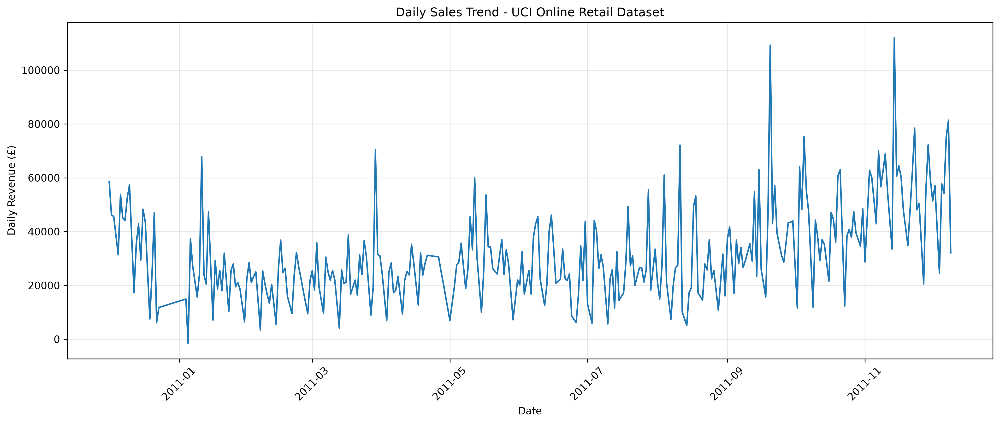

# VoltMart Transaction Anomaly Detection Dashboard

## Project Overview

This project is being developed for VoltMart Electronics as part of a Data Science internship task.

The objective of Task 1 is to load retail transaction data, calculate daily revenue, and visualize daily sales trends using Python.

**Dataset note:** This project uses the publicly available UCI Online Retail dataset as sample data. It is not actual VoltMart company transaction data.

## Dataset

- **Source:** [UCI Online Retail Dataset](https://archive.ics.uci.edu/ml/datasets/Online+Retail)
- **Input file:** `data/Online_Retail.csv`
- **Records:** 541,909 transactions
- **Columns:** 8
- **Date range:** December 2010 – December 2011

## Project Structure

```text
voltmart-transaction-anomaly-detection/
│
├── data/
│   └── Online_Retail.csv
│
├── scripts/
│   ├── eda.py
│   └── load_and_plot.py
│
├── outputs/
│   └── daily_sales.png
│
├── requirements.txt
└── README.md
```

## Installation

Create and activate a Python virtual environment, then install the required packages:

```bash
python -m pip install -r requirements.txt
```

## Generate Daily Sales Chart

Run the following command from the project root directory:

```bash
python scripts/load_and_plot.py
```

The script calculates transaction revenue using:

`Revenue = Quantity × UnitPrice`

It then groups revenue by transaction date and generates a daily sales trend chart.

The output image is saved at:

`outputs/daily_sales.png`

## Daily Sales Trend



## Technologies Used

- Python
- Pandas
- Matplotlib
- OpenPyXL

## Task 1 Results

- Successfully loaded the retail transaction dataset.
- Converted transaction dates into datetime format.
- Calculated revenue for each transaction.
- Aggregated revenue by day.
- Generated and saved the daily sales trend chart.

**Recorded sales days:** 305

## Notes

This is Task 1 of the larger transaction anomaly detection project. Feature engineering, Isolation Forest anomaly detection, and the interactive Streamlit dashboard are planned for subsequent tasks.